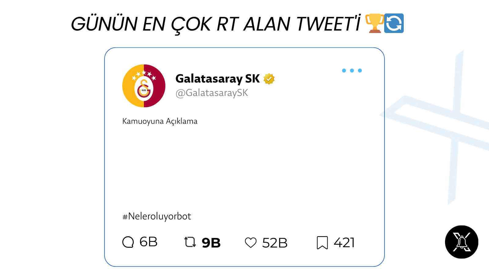

<div align="center">
  
</div>

# ViralTweet - Automated Social Media Trend Tracker


**ViralTweet**, Twitter / X üzerindeki en popüler ve viral gönderileri (en çok beğeni ve en çok retweet alan tweetleri) otomatik olarak tarayan, filtreleyen ve Telegram kanalınıza veya grubunuza anlık olarak raporlayan gelişmiş bir Python botudur.

---

### 🚀 Özellikler (Features)

*   **Akıllı Kazıma (Playwright):** Modern Twitter / X React arayüzü ve sanallaştırılmış liste yapısına uygun dinamik veri çekme.
*   **Gelişmiş Metrik Ayrıştırma:** Türkçe ve İngilizce beğeni/RT formatlarını (örn. `25.432`, `12.4K`, `1,5 B`, `2,5 Mn`, `150 Bin`) hatasız sayısal değere çevirme.
*   **Esnek Kimlik Doğrulama:**
    *   İster otomatik `python get_cookies.py` ile tarayıcıdan tek tıkla `cookies.json` oluşturma,
    *   İster `.env` içerisine tek satır `TWITTER_AUTH_TOKEN` yazarak çalışma,
    *   İster GitHub Secrets üzerinden tam otomatik çalışma.
*   **Telegram Bildirimi:** Güvenli HTML formatı ile kullanıcı adlarında alt çizgi (`_`) gibi karakterler olsa bile çökmeden şık bildirim kartı gönderme.
*   **Adaptif Filtreleme:** Günün etkileşim seviyesine göre kademeli eşik (threshold) denemesi ile hiçbir günü boş geçmeme.

---

### 🛠️ Kurulum (Installation)

1.  **Projeyi Klonlayın:**
    ```bash
    git clone https://github.com/ardakilicaslan/viral-tweet.git
    cd viral-tweet
    ```

2.  **Sanal Ortam Oluşturun (Önerilen):**
    ```bash
    python -m venv venv
    # Windows için:
    venv\Scripts\activate
    # Mac/Linux için:
    source venv/bin/activate
    ```

3.  **Bağımlılıkları Yükleyin:**
    ```bash
    pip install -r requirements.txt
    playwright install chromium
    ```

---

### 🍪 Twitter / X Girişi (Kimlik Doğrulama)

X (Twitter) arama sayfalarına erişebilmek için oturum açılmış olmalıdır. Bunun için 2 kolay yöntem vardır:

#### Seçenek A: Otomatik Araç (En Kolayı)
```bash
python get_cookies.py
```
Açılan pencerede Twitter hesabınıza giriş yapın ve terminale dönüp **ENTER** tuşuna basın. `cookies.json` otomatik oluşturulacaktır!

#### Seçenek B: `.env` Dosyasına Token Eklemek
Tarayıcınızda (F12 -> Uygulama / Application -> Çerezler / Cookies -> `x.com`) listesindeki **`auth_token`** değerini kopyalayıp `.env` dosyasına yazın:
```env
TWITTER_AUTH_TOKEN=kopyalanan_auth_token_degeri
```

---

### ⚙️ Yapılandırma (.env)

`.env.example` dosyasını `.env` olarak kopyalayın:

```env
# Telegram Bot Bilgileri
BOT_TOKEN=123456789:ABCdefGhIJKlmNoPQRsTUVwxyZ
CHAT_ID=123456789

# Twitter Girişi (cookies.json varsa zorunlu değildir)
TWITTER_AUTH_TOKEN=
TWITTER_CT0=
```

---

### ▶️ Kullanım (Usage)

Botu çalıştırmak için:

```bash
python main.py
```

Tarayıcıyı arka planda gizli değil, ekranda görerek çalıştırmak isterseniz:
```bash
python main.py --no-headless
```

Belirli bir gün için geriye dönük arama yapmak isterseniz:
```bash
python main.py --date 2026-10-10
```

---

### 🤖 GitHub Actions ile Otomatik Çalıştırma

Botun her gece kendi kendine çalışıp Telegram'a mesaj atması için:
1. GitHub reponuzda **Settings -> Secrets and variables -> Actions** bölümüne gidin.
2. Aşağıdaki Secret'ları ekleyin:
   * `BOT_TOKEN`: Telegram bot tokenınız
   * `CHAT_ID`: Telegram chat id'niz
   * `TWITTER_AUTH_TOKEN`: X hesabınızın auth_token çerezi (veya `TWITTER_COOKIES` JSON'ı)
3. `.github/workflows/daily_bot.yml` her gece TR saatiyle 00:00'da otomatik çalışacaktır!

---

### 📸 Ekran Görüntüleri (Screenshots)

<div align="center">
  
</div>

<div align="center">
  
  
</div>

---

### 👨‍💻 Geliştirici

Geliştirici: **[@ardakilicaslan](https://github.com/ardakilicaslan)**
